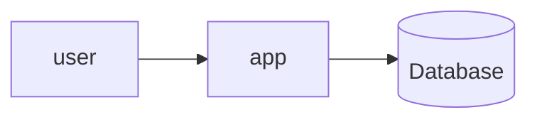

# Architecture

> Replace this with your system once it exists. Keep it short and current.

## Overview

<!-- One paragraph: what the system does and for whom. -->

## Components

| Component | Responsibility | Tech |
|-----------|----------------|------|
| app | Serves the API / UI | Docker container |

## Data flow

<!-- Request path from user to storage and back. A mermaid diagram works well:

-->

## Decisions

Record significant decisions as short ADRs: context, decision, consequences.
